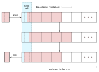

# Copying Stack

This is the default implementation of the [sediment buffer](../components/sediment_buffer.md). The buffer is stored as a 4-dimensional array (depth, facies, $x$, $y$), but it is best to explain its functioning from the perspective of a single cell in our model. We are left with two dimensions: depth (rows) and facies (columns).

We choose to have the head of our sediment stack always be at the first row. When sediment out-grows the buffer, the deepest layers are dropped from memory. The head can contain an incomplete amount of sediment, while all rows below the head are either full or empty. When sediment is pushed to the stack and the head row overflows, all rows are copied down one row and the surplus is assigned to the now empty head row. The inverse happens when removing (popping) material from the stack (in computer science stacks are pushed on and popped from). This process is illustrated below.



Above we see a buffer. First we push a parcel of size $3/4$, then we pop an amount of $1/2$. This popped parcel will have different fractions from the pushed one, since it also draws from the half filled row that was in the stack before pushing. In this sense, a small amount of facies mixing will take place, depending on the depositional resolution chosen.

Our implementation is such that each cell in the buffer is contiguous in memory. Thus, copying rows of unstrided memory should be very efficient, although the performance remains to be tested. The [circular buffer](circular_stack.md) avoids copying altogether.

## Implementation

We define two functions `push_sediment!` and `pop_sediment!`. Given a $s \times n$ matrix, where $n$ is the number of facies types and $s$ is the depth of the stack, we can grow and shrink sediment. These functions are unit-free, setting $\Delta z$ to be equal to 1.

``` {.julia file=test/Algorithms/CopyingBuffersSpec.jl}
module CopyingBuffersSpec
using Test
using CarboKitten.Algorithms.CopyingBuffers: push_sediment!, pop_sediment!, peek_sediment

@testset "Algorithms/CopyingBuffers" begin
  @testset "column" begin
    stack = zeros(Float64, 10, 3)
    @test pop_sediment!(stack, 0.0) == [0.0, 0.0, 0.0]
    push_sediment!(stack, [5.0, 0, 0])
    @test pop_sediment!(stack, 1.5) == [1.5, 0.0, 0.0]
    push_sediment!(stack, [0.0, 2.0, 0.0])   # (0 0.5) (0 1) (0.5 0.5) (1 0) ...
    @test pop_sediment!(stack, 2.0) == [0.25, 1.75, 0.0]
    @test pop_sediment!(stack, 1.5) == [1.25, 0.25, 0.0]
    @test pop_sediment!(stack, 0.0) == [0.0, 0.0, 0.0]

    stack2 = zeros(Float64, 10, 3)
    push_sediment!(stack2, [1.0, 0.0, 0.0])
    @test peek_sediment(stack2, 1.0) == [1.0, 0.0, 0.0]
  end

  @testset "edge cases" begin
    # pushing more than the buffer can hold fills every row with the parcel's fractions
    stack = zeros(Float64, 4, 2)
    @test_logs (:warn,) push_sediment!(stack, [6.0, 2.0])
    @test all(stack .== [0.75 0.25])

    # popping several rows from a full buffer keeps the deepest rows
    stack = [1.0 0.0; 1.0 0.0; 0.0 1.0; 0.0 1.0]
    @test pop_sediment!(stack, 2.0) == [2.0, 0.0]
    @test stack == [0.0 1.0; 0.0 1.0; 0.0 0.0; 0.0 0.0]

    # popping more than the buffer holds returns everything, counting each row once
    stack = [1.0 0.0; 1.0 0.0; 0.0 1.0; 0.0 1.0]
    @test (@test_logs (:error,) pop_sediment!(stack, 10.0)) == [2.0, 2.0]
    @test all(stack .== 0.0)

    # peeking deeper than the buffer returns its entire contents
    stack = [0.5 0.0; 1.0 0.0; 0.0 1.0; 0.0 1.0]
    @test peek_sediment(stack, 10.0) == [1.5, 2.0]
  end

  @testset "grid" begin
    sediment = zeros(Float64, 10, 3, 5, 5)
    for x in 1:10
      production = rand(3, 5, 5)
      push_sediment!(sediment, production)
    end
    a = peek_sediment(sediment, 1.0)
    @test all(sum(a; dims=1) .≈ 1.0)

    out = zeros(Float64, 3, 5, 5)
    pop_sediment!(sediment, fill(1.0, 5, 5), out)
    @test out ≈ a
  end
end
end
```

### Shifting rows

Both pushing and popping need to move rows of the buffer up or down. These shifts are done in place. Since source and destination overlap, the order of iteration matters: when shifting down we start at the bottom, when shifting up we start at the top. Rows that are shifted in are left untouched; the caller should overwrite them.

``` {.julia #copying-buffer-impl}
@inline function shift_down!(col::AbstractMatrix, k::Int)
    s = size(col, 1)
    @inbounds for j in axes(col, 2), i in s:-1:k+1
        col[i, j] = col[i - k, j]
    end
end

@inline function shift_up!(col::AbstractMatrix, k::Int)
    s = size(col, 1)
    @inbounds for j in axes(col, 2), i in 1:s-k
        col[i, j] = col[i + k, j]
    end
end
```

### Pushing sediment

The single-cell version of `push_sediment!` takes as argument `col` a column (physically speaking a column of sediment) represented by a $s \times n$-matrix and a parcel a $n$-vector.

``` {.julia #copying-buffer-impl}
function push_sediment!(col::AbstractMatrix{F}, parcel::AbstractVector{F}) where F <: Real
    @assert size(col, 2) == length(parcel) "column $(size(col)) doesn't match parcel $(size(parcel))"
    <<push-sediment>>
end
```

First we check if the amount of sediment is larger than the buffer. A warning is printed and the entire buffer filled in the specified fractions.

``` {.julia #push-sediment}
mass = sum(parcel)
if mass == 0.0
    return
end

if mass > size(col)[1]
    @warn "pushing a very large parcel of sediment: $mass times depositional resolution"
    col .= transpose(parcel ./ mass)
    return
end
```

First we determine the total sediment amount $\Delta$, being the sum of the parcel, as well as the amount of sediment in our *bucket*, the head row.

``` {.julia #push-sediment}
bucket = sum(@view col[1, :])
@assert bucket >= 0.0 && bucket <= 1.0
```

If the bucket has enough space left for the parcel, we can just add the parcel to the bucket and return.

``` {.julia #push-sediment}
if bucket + mass < 1.0
    @views col[1, :] .+= parcel
    return
end
```

Otherwise, the normalized fractions of facies in the parcel are `parcel ./ total`. We add as much sediment as we can to fill the bucket and copy rows down as far as needed.

``` {.julia #push-sediment}
total = mass
space = 1.0 - bucket
@views col[1, :] .+= parcel ./ total .* space
mass -= space
n = floor(Int64, mass)

shift_down!(col, n + 1)
```

If the parcel has enough material left to fill more rows, those are all filled with the normalized fractions. The head row is assigned whatever is left.

``` {.julia #push-sediment}
mass -= n
for j in axes(col, 2)
    frac = parcel[j] / total
    col[2:n+1, j] .= frac
    col[1, j] = frac * mass
end
```

### Popping sediment

Similar to `push_sediment!` we have `pop_sediment!`. We give `pop_sediment!` the sedimentary column `col`, the total amount of sediment we require and an output vector `parcel` that will contain the popped sediment. A two-argument version allocates the output for us. There is a bit that we will reuse called `pop_fraction!`, which only works if the amount of popped sediment is lower than the contents of the bucket. It adds the popped sediment to `parcel`.

``` {.julia #copying-buffer-impl}
@inline function pop_fraction!(parcel::AbstractVector{F}, col::AbstractMatrix{F}, mass::F) where F <: Real
    bucket = sum(@view col[1, :])
    if mass == 0 || bucket == 0
        return parcel
    end

    @assert mass < bucket "pop_fraction can only pop from the top cell: $(col), $(mass)"
    r = mass / bucket
    for j in axes(col, 2)
        p = r * col[1, j]
        parcel[j] += p
        col[1, j] -= p
    end
    return parcel
end

function pop_sediment!(col::AbstractMatrix{F}, Δ::F, parcel::AbstractVector{F}) where F <: Real
    <<pop-sediment>>
end

pop_sediment!(col::AbstractMatrix{F}, Δ::F) where F <: Real =
    pop_sediment!(col, Δ, zeros(F, size(col, 2)))
```

We start by computing the bucket size again. If it is greater than the required amount, we call `pop_fraction!`.

``` {.julia #pop-sediment}
bucket = sum(@view col[1, :])
@assert bucket >= 0.0

if Δ < bucket
    parcel .= zero(F)
    return pop_fraction!(parcel, col, Δ)
end
```

Otherwise, we start a parcel with the contents of the bucket. Add to that the remaining material in rows below. Now we copy rows from below, setting the bottom $n$ rows to 0. The last step is to call `pop_fraction!` one more time with the remaining required amount.

``` {.julia #pop-sediment}
@views parcel .= col[1, :]
Δ -= bucket
n = floor(Int64, Δ)

if n > (size(col)[1] - 2)
    @error "too much material popped of the stack: Δ = $Δ"
    for j in axes(col, 2)
        parcel[j] = sum(@view col[:, j])
    end
    col .= 0.0
    return parcel
end

for j in axes(col, 2)
    parcel[j] += sum(@view col[2:n+1, j])
end
shift_up!(col, n + 1)
col[end-n:end, :] .= 0
Δ -= n

return pop_fraction!(parcel, col, Δ)
```

### Peeking

Instead of popping sediment, we can also *peek* at the stack with `peek_sediment`, which is a non-destructive way to inspect what the returned parcel would be if we were to call `pop_sediment!` with the same arguments. Peeking deeper than the buffer returns its entire contents.

``` {.julia #copying-buffer-impl}
function peek_sediment(col::AbstractMatrix{F}, Δ::F) where F <: Real  # -> Vector{F}
    if Δ == 0
        return zeros(F, size(col, 2))
    end

    bucket = sum(@view col[1, :])
    if Δ < bucket
        return (Δ / bucket) .* col[1, :]
    end

    parcel = col[1, :]
    Δ -= bucket
    n = min(floor(Int64, Δ), size(col, 1) - 1)

    for j in axes(col, 2)
        parcel[j] += sum(@view col[2:n+1, j])
    end
    Δ -= n

    if n + 2 <= size(col, 1)
        last_bucket = sum(@view col[n+2, :])
        if last_bucket > 0
            @views parcel .+= (Δ / last_bucket) .* col[n+2, :]
        end
    end

    return parcel
end
```

### Grid

The buffer for the entire grid is a 4-dimensional array. Methods taking a `CartesianIndex` work on a single column of that grid, while the remaining methods loop over all columns.

``` {.julia #copying-buffer-impl}
push_sediment!(buffer::AbstractArray{F, 4}, i::CartesianIndex{2}, parcel::AbstractVector{F}) where F <: Real =
    push_sediment!(view(buffer, :, :, i), parcel)

pop_sediment!(buffer::AbstractArray{F, 4}, i::CartesianIndex{2}, Δ::F, parcel::AbstractVector{F}) where F <: Real =
    pop_sediment!(view(buffer, :, :, i), Δ, parcel)

peek_sediment(buffer::AbstractArray{F, 4}, i::CartesianIndex{2}, Δ::F) where F <: Real =
    peek_sediment(view(buffer, :, :, i), Δ)

function push_sediment!(buffer::AbstractArray{F, 4}, p::AbstractArray{F, 3}) where F <: Real
    @assert size(buffer, 2) == size(p, 1) "shapes for buffer $(size(buffer)) doesn't match p $(size(p))"
    @views for i in CartesianIndices(size(p)[2:3])
        push_sediment!(buffer, i, p[:, i])
    end
end

function pop_sediment!(buffer::AbstractArray{F, 4}, amount::AbstractArray{F, 2}, out::AbstractArray{F, 3}) where F <: Real
    @views for i in CartesianIndices(amount)
        pop_sediment!(buffer, i, amount[i], out[:, i])
    end
end

function peek_sediment(buffer::AbstractArray{F, 4}, Δ::F) where F <: Real
    _, f, x, y = size(buffer)
    out = Array{F, 3}(undef, f, x, y)
    for i in CartesianIndices((x, y))
        out[:, i] = peek_sediment(buffer, i, Δ)
    end
    return out
end
```

```@raw html
<details><summary>CopyingBuffers module</summary>
```

``` {.julia file=src/Algorithms/CopyingBuffers.jl}
module CopyingBuffers

export push_sediment!, pop_sediment!, peek_sediment

<<copying-buffer-impl>>

end # module
```

```@raw html
</details>
```
