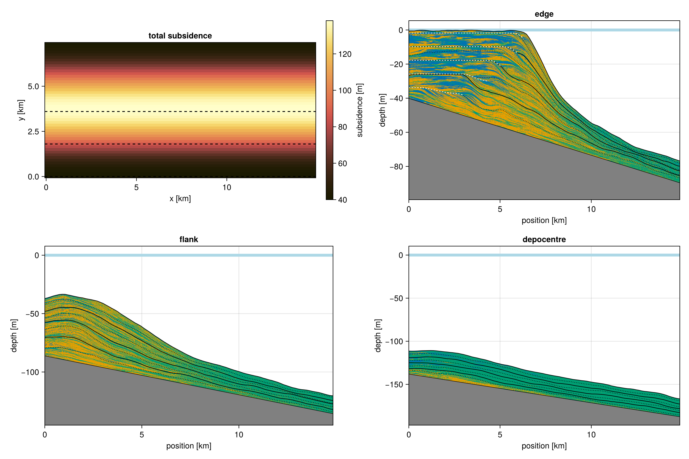

# Variable subsidence

By default, CarboKitten uses a constant subsidence rate. In many settings this is not realistic: rift basins subside fastest during active faulting and slow down as the fault dies out, and fault blocks tilt, so the subsidence rate varies across the platform. The `subsidence_rate` input therefore also accepts a function of time, or of space and time.

```julia
# subsidence that slows down over time, e.g. thermal subsidence
subsidence_rate = TimeVariableSubsidenceRate(t -> 100.0u"m/Myr" * exp(-t / 0.5u"Myr"))

# subsidence that varies in space and time
subsidence_rate = SpaceTimeVariableSubsidenceRate((x, y, t) -> ...)
```

The functions take times in Myr and positions in m, and should return a rate (e.g. in m/Myr). See the [Water Depth component](../components/waterdepth.md) for details.

## A subsiding depocentre

We model a platform on a margin where active faulting creates a local depocentre. Our coastal box is 15 km in the $x$ direction (onshore to offshore) and 7.5 km in the $y$ direction (along strike). The extra subsidence is largest in the middle of the box and falls off towards the edges in $y$. Fault activity wanes during the run, so the tectonic part of the subsidence decays exponentially with a time scale of 0.25 Myr. On top of that, there is a constant background subsidence of 40 m/Myr.

$$\sigma(x, y, t) = \sigma_0 + \sigma_{\rm fault} \sin^2\left(\frac{\pi y}{W}\right) e^{-t/\tau}$$

At the edges of the box the platform only sees the background subsidence. In the centre of the depocentre, the initial rate of 440 m/Myr is about as fast as the carbonate factory can produce. The total amount of extra subsidence there is $\sigma_{\rm fault} \tau (1 - e^{-T/\tau}) \approx 98$ m.

!!! warning "Mind the boundaries"

    The `Coast` boundary type is periodic in the $y$ direction. A subsidence pattern that is not periodic in $y$, like a linear tilt along strike, creates a step in the bathymetry at the boundary. Over time, this step grows into a cliff that causes unrealistic transport of sediment. Make sure that your subsidence pattern is consistent with the boundary conditions of your box.

``` {.julia #variable-subsidence-rate}
const BOX = Box{Coast}(grid_size=(100, 50), phys_scale=150.0u"m")
const WIDTH = BOX.grid_size[2] * BOX.phys_scale

const BACKGROUND_RATE = 40.0u"m/Myr"
const FAULT_RATE = 400.0u"m/Myr"
const FAULT_DECAY = 0.25u"Myr"

subsidence(x, y, t) = BACKGROUND_RATE +
    FAULT_RATE * sin(π * y / WIDTH)^2 * exp(-t / FAULT_DECAY)
```

Apart from subsidence, we use the same input as the [ALCAP example](../models/alcap.md), and store three profiles along the $x$ direction: at the edge of the box, halfway, and in the centre of the depocentre.

``` {.julia .task file=examples/variable-subsidence/run.jl}
#| creates: data/output/variable-subsidence.h5
#| requires: src/Components/WaterDepth.jl

module VariableSubsidence

using CarboKitten

const PATH = "data/output"
const TAG = "variable-subsidence"

<<variable-subsidence-rate>>

const PROFILES = [:edge => 1, :flank => 13, :centre => 25]

const INPUT = ALCAP.Input(
    tag=TAG,
    box=BOX,
    time=TimeProperties(
        Δt=0.0002u"Myr",
        steps=5000),
    output=Dict(
        :topography => OutputSpec(slice=(:, :), write_interval=100),
        (k => OutputSpec(slice=(:, j), write_interval=1) for (k, j) in PROFILES)...),
    ca_interval=1,
    initial_topography=(x, y) -> -x / 300.0,
    sea_level=t -> 4.0u"m" * sin(2π * t / 0.2u"Myr"),
    subsidence_rate=SpaceTimeVariableSubsidenceRate(subsidence),
    disintegration_rate=50.0u"m/Myr",
    lithification_time=100.0u"yr",
    insolation=400.0u"W/m^2",
    sediment_buffer_size=50,
    depositional_resolution=0.5u"m",
    facies=ALCAP.Example.FACIES)

function main()
    mkpath(PATH)
    run_model(Model{ALCAP}, INPUT, joinpath(PATH, "$(TAG).h5"))
end

end

VariableSubsidence.main()
```

## Result



The top-left panel shows the total subsidence over the run, with the locations of the three profiles marked by dashed lines. At the edge, the platform keeps up with the background subsidence and progrades as usual. On the flank, the early pulse of subsidence outpaces production: the platform drowns, and what remains is an aggrading wedge in 40-100 m of water, dominated by the deeper water facies. In the centre of the depocentre the platform never gets started, and the sediment that does accumulate is almost entirely aphotic. Once the fault activity has died out, the remaining subsidence is slow enough to keep up with, but by then the sea floor is too deep for the euphotic factory to recover. Note that the bedrock in the profile plots is corrected for the subsidence at each location: `bedrock(header)` uses the total subsidence stored in the output file.

``` {.julia .task file=examples/variable-subsidence/plot.jl}
#| creates: docs/src/_fig/variable-subsidence.png
#| requires: data/output/variable-subsidence.h5
#| collect: figures

module PlotVariableSubsidence

using CairoMakie
using CarboKitten
using CarboKitten.Output: total_subsidence
using CarboKitten.Visualization: sediment_profile!

const FILENAME = "data/output/variable-subsidence.h5"

function main()
    bundle = load(FILENAME)
    fig = Figure(size=(1200, 800))

    profiles = [:edge => "edge", :flank => "flank", :centre => "depocentre"]
    slices = [load_slice(bundle, k) for (k, _) in profiles]
    hdr = slices[1].header

    ax0 = Axis(fig[1, 1]; title="total subsidence", xlabel="x [km]", ylabel="y [km]",
               aspect=DataAspect())
    hm = heatmap!(ax0, hdr.axes.x |> in_units_of(u"km"), hdr.axes.y |> in_units_of(u"km"),
                  total_subsidence(hdr) |> in_units_of(u"m"); colormap=:lajolla)
    for (p, _) in zip(slices, profiles)
        y = p.header.axes.y[p.data.slice[2]] |> in_units_of(u"km")
        hlines!(ax0, y; color=:black, linestyle=:dash)
    end
    Colorbar(fig[1, 2], hm; label="subsidence [m]")

    positions = [fig[1, 3], fig[2, 1:2], fig[2, 3]]
    for (pos, p, (_, title)) in zip(positions, slices, profiles)
        ax = Axis(pos)
        sediment_profile!(ax, p)
        ax.title = title
    end

    close(bundle)
    save("docs/src/_fig/variable-subsidence.png", fig)
end

end

PlotVariableSubsidence.main()
```
