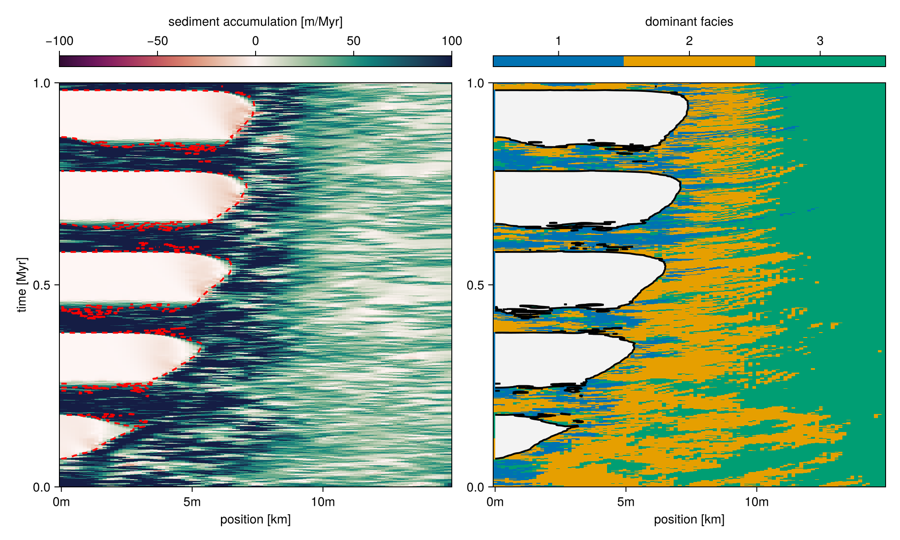
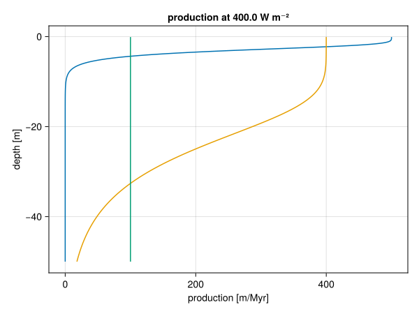

## Wheeler diagram



``` {.julia .task file=examples/visualization/wheeler_diagram.jl}
#| creates: docs/src/_fig/wheeler_diagram.png
#| requires: data/output/alcap-example.h5
#| collect: figures

module Script

using CairoMakie
using CarboKitten.Export: read_slice
using CarboKitten.Visualization: wheeler_diagram

function main()
  header, data = read_slice("data/output/alcap-example.h5", :profile)
  fig = wheeler_diagram(header, data)
  save("docs/src/_fig/wheeler_diagram.png", fig)
end

end

Script.main()
```

``` {.julia file=ext/WheelerDiagram.jl}
module WheelerDiagram

import CarboKitten.Visualization: wheeler_diagram, wheeler_diagram!, sediment_accumulation!, dominant_facies!
using CarboKitten.Utility: in_units_of
using CarboKitten.Output.Storage: Header, DataSlice, Pack, PackSlice,
    stratigraphic_column, water_depth, deposition, net_deposition, n_facies,
    time_axis, write_time_step, section_axis
using Makie
using Unitful
using CarboKitten.BoundaryTrait
using CarboKitten.Stencil: convolution

const Rate = typeof(1.0u"m/Myr")

function sediment_accumulation!(ax::Axis, p::PackSlice;
    smooth_size::NTuple{2,Int}=(3, 11),
    colormap=Reverse(:curl),
    range::NTuple{2,Rate}=(-100.0u"m/Myr", 100.0u"m/Myr"))
    magnitude = dropdims(sum(net_deposition(p); dims=1), dims=1) ./ write_time_step(p)
    blur = convolution(Shelf, ones(Float64, smooth_size...) ./ *(smooth_size...))
    mag = zeros(Float64, size(magnitude))
    blur(magnitude / u"m/Myr", mag)

    ax.ylabel = "time [Myr]"
    ax.xlabel = "position [km]"
    xkm = section_axis(p) |> in_units_of(u"km")
    tmyr = time_axis(p) |> in_units_of(u"Myr")

    sa = heatmap!(ax, xkm, tmyr, mag;
        colormap=colormap, colorrange=range ./ u"m/Myr")
    return sa
end

function dominant_facies!(ax::Axis, p::PackSlice;
    show::Symbol = :both,
    smooth_size::NTuple{2,Int} = (3, 11),
    colors = Makie.wong_colors())

    if show ∉ [:model, :preserved, :both]
        error("expected argument `show` to be one of `:model`, `:preserved`, `:both`; got $(show)")
    end

    prec = 10^-8 # prec. in m - below acc. is considered 0

    n_f = n_facies(p)
    colormax(d) = getindex.(argmax(d; dims=1)[1, :, :], 1)

    blur = convolution(Shelf, ones(Float64, smooth_size...) ./ *(smooth_size...))
    wd_raw = water_depth(p) / u"m"
    wd = zeros(Float64, size(wd_raw))
    blur(wd_raw, wd)

    ax.ylabel = "time [Myr]"
    ax.xlabel = "position [km]"

    xkm = section_axis(p) |> in_units_of(u"km")
    tmyr = time_axis(p) |> in_units_of(u"Myr")

    ft = if show == :model
        dominant_facies = colormax(deposition(p))
        dominant_facies = Matrix{Union{Missing, Int}}(dominant_facies)
        dominant_facies[ wd .> 0] .= missing
        heatmap!(ax, xkm, tmyr, dominant_facies;
            colormap=cgrad(colors[1:n_f], n_f, categorical=true),
            colorrange=(0.5, n_f + 0.5),
            nan_color=:white)
    elseif show == :preserved
        sc = stratigraphic_column(p)
        dominant_facies = colormax(sc)
        dominant_facies = Matrix{Union{Missing, Int}}(dominant_facies)
        combined_acc = dropdims(sum(sc, dims = 1), dims = 1) |> in_units_of(u"m")
        dominant_facies[ combined_acc .< prec] .= missing
        heatmap!(ax, xkm, tmyr, dominant_facies;
            colormap=cgrad(colors[1:n_f], n_f, categorical=true),
            colorrange=(0.5, n_f + 0.5),
            nan_color=:white)
    else
        sc = stratigraphic_column(p)
        dominant_facies_model = colormax(deposition(p))
        dominant_facies_model = Matrix{Union{Missing, Int}}(dominant_facies_model)
        dominant_facies_model[ wd .> 0] .= missing
        heatmap!(ax, xkm, tmyr, dominant_facies_model;
            colormap=cgrad(colors[1:n_f], n_f, categorical=true),
            colorrange=(0.5, n_f + 0.5), alpha=0.3,
            nan_color=:white)
        dominant_facies_preserved = colormax(sc)
        dominant_facies_preserved = Matrix{Union{Missing, Int}}(dominant_facies_preserved)
        combined_acc = dropdims(sum(sc, dims = 1), dims = 1) |> in_units_of(u"m")
        dominant_facies_preserved[ combined_acc .< prec] .= missing
        heatmap!(ax, xkm, tmyr, dominant_facies_preserved;
            colormap=cgrad(colors[1:n_f], n_f, categorical=true),
            colorrange=(0.5, n_f + 0.5),
            nan_color=:transparent)
    end

    return ft
end

function wheeler_diagram!(ax1::Axis, ax2::Axis, p::PackSlice;
    smooth_size::NTuple{2,Int}=(3, 11),
    range::NTuple{2,Rate}=(-100.0u"m/Myr", 100.0u"m/Myr"))

    linkyaxes!(ax1, ax2)
    sa = sediment_accumulation!(ax1, p; smooth_size=smooth_size, range=range)
    ft = dominant_facies!(ax2, p; smooth_size=smooth_size)
    ax2.ylabel = ""

    return sa, ft
end

function wheeler_diagram(p::PackSlice;
    smooth_size::NTuple{2,Int}=(3, 11),
    range::NTuple{2,Rate}=(-100.0u"m/Myr", 100.0u"m/Myr"))

    fig = Figure(size=(1000, 600))
    ax1 = Axis(fig[2, 1])
    ax2 = Axis(fig[2, 2])

    sa, ft = wheeler_diagram!(ax1, ax2, p; smooth_size=smooth_size, range=range)

    Colorbar(fig[1, 1], sa; vertical=false, label="sediment accumulation [m/Myr]")
    Colorbar(fig[1, 2], ft; vertical=false, ticks=1:n_facies(p), label="dominant facies")
    fig
end

# Methods accepting a `Header`, `DataSlice` pair, kept for backward compatibility.
sediment_accumulation!(ax::Axis, header::Header, data::DataSlice; kwargs...) =
    sediment_accumulation!(ax, Pack(header, data); kwargs...)
dominant_facies!(ax::Axis, header::Header, data::DataSlice; kwargs...) =
    dominant_facies!(ax, Pack(header, data); kwargs...)
wheeler_diagram!(ax1::Axis, ax2::Axis, header::Header, data::DataSlice; kwargs...) =
    wheeler_diagram!(ax1, ax2, Pack(header, data); kwargs...)
wheeler_diagram(header::Header, data::DataSlice; kwargs...) =
    wheeler_diagram(Pack(header, data); kwargs...)

end
```

## Production curve



``` {.julia .task file=examples/visualization/production_curve.jl}
#| creates: docs/src/_fig/production_curve.svg
#| requires: data/output/alcap-example.h5
#| collect: figures

using CairoMakie
using CarboKitten.Visualization: production_curve

save("docs/src/_fig/production_curve.svg", production_curve("data/output/alcap-example.h5"))
```

``` {.julia file=ext/ProductionCurve.jl}
module ProductionCurve

using Makie
using Unitful
using HDF5
using Interpolations

import CarboKitten.Components.Common: AbstractInput
import CarboKitten.Visualization: production_curve!, production_curve

using CarboKitten.Production: production_profile
using CarboKitten.Utility: in_units_of

_meters(d::Quantity) = ustrip(u"m", d)
_meters(d::Real) = d

# ---------------------------------------------------------------------------
# In-memory form: evaluate production_profile directly
# ---------------------------------------------------------------------------

"""
    production_curve!(ax, input; colors=Makie.wong_colors(), max_depth=nothing)

Plot production rate vs depth for each facies in `input`. The production
profile `(t, w) -> rate` is evaluated at the initial time (t=0) over a depth
range determined by the facies definitions, or down to `max_depth` if given.
Facies `i` is drawn in `colors[i]`, matching the facies colours of the other
plots.
"""
function production_curve!(ax::Axis, input::I; colors = Makie.wong_colors(),
                           max_depth = nothing) where {I <: AbstractInput}
    ax.xlabel = "production [m/Myr]"
    ax.ylabel = "depth [m]"
    ax.yreversed = true

    t0 = input.time.t0

    max_d = 50.0u"m"
    for f in input.facies
        p = f.production
        if hasproperty(p, :depth_knots) && !isempty(p.depth_knots)
            max_d = max(max_d, maximum(p.depth_knots))
        end
    end

    if max_depth !== nothing
        max_d = _meters(max_depth) * u"m"
    end

    depth = (0.1u"m":0.1u"m":max_d)

    for (i, f) in enumerate(input.facies)
        profile = production_profile(input, f.production)
        prod = [profile(t0, d) for d in depth]
        lines!(ax, prod .|> in_units_of(u"m/Myr"), depth .|> in_units_of(u"m");
               color = colors[mod1(i, length(colors))],
               label = "facies $(i)")
    end
end

function production_curve(input::I) where {I <: AbstractInput}
    fig = Figure()
    ax  = Axis(fig[1, 1])
    production_curve!(ax, input)
    Legend(fig[1, 2], ax)
    return fig
end

# ---------------------------------------------------------------------------
# HDF5 form: read the generic 2D production table
# ---------------------------------------------------------------------------

"""
    production_curve!(ax, g::HDF5.Group; n_time_samples=5, colors=Makie.wong_colors(), max_depth=nothing)

Plot production rate vs depth from the 2D production table saved in the HDF5
`input` group. Each facies is shown as a family of `n_time_samples` curves
at representative times (darker = later). No knowledge of the underlying
production type is required. All curves of facies `i` are drawn in
`colors[i]`, matching the facies colours of the other plots. If `max_depth`
is given (a length, or a number in meters), only depths down to `max_depth`
are shown.
"""
function production_curve!(ax, g::HDF5.Group; n_time_samples::Int = 5,
                           colors = Makie.wong_colors(), max_depth = nothing)
    ax.xlabel = "production [m/Myr]"
    ax.ylabel = "depth [m]"
    ax.yreversed = true

    a = HDF5.attributes(g)
    n_facies = a["n_facies"][]

    for i in 1:n_facies
        key = "facies$(i)"
        haskey(g, key) || continue
        fg = g[key]
        haskey(fg, "production_table") || continue

        table      = read(fg["production_table"])      # (n_depth, n_time)
        depth_axis = read(fg["production_depth_axis"]) # m
        if max_depth !== nothing
            sel = depth_axis .<= _meters(max_depth)
            table, depth_axis = table[sel, :], depth_axis[sel]
        end
        n_d, n_t   = size(table)

        t_idx = unique(round.(Int, LinRange(1, n_t, min(n_time_samples, n_t))))

        for (k, ti) in enumerate(t_idx)
            alpha = 0.3 + 0.7 * k / length(t_idx)
            label = k == 1 ? "facies $(i)" : nothing
            lines!(ax, table[:, ti], depth_axis;
                   color = colors[mod1(i, length(colors))],
                   label = label, alpha = alpha)
        end
    end
end

function production_curve(filename::AbstractString; kwargs...)
    h5open(filename, "r") do fid
        fig = Figure()
        ax  = Axis(fig[1, 1])
        production_curve!(ax, fid["input"]; kwargs...)
        Legend(fig[1, 2], ax)
        return fig
    end
end

end
```

## Stratigraphic Column

``` {.julia file=ext/StratigraphicColumn.jl}
module StratigraphicColumn

using Makie
using Unitful

import CarboKitten.Visualization: stratigraphic_column!
using CarboKitten.Export: age_depth_model
using CarboKitten.Output.Storage: Header, DataColumn, Pack, PackColumn,
    stratigraphic_column, sediment_thickness


function scdata(p::PackColumn)
    sc = stratigraphic_column(p) / u"m"

    colormax(d) = getindex.(argmax(d; dims=1)[1, :], 1)
    adm = age_depth_model(sediment_thickness(p))

    return (ys_low=adm[1:end-1] / u"m", ys_high=adm[2:end] / u"m", facies=colormax(sc)[1:end-1])
end


function stratigraphic_column!(ax::Axis, p::PackColumn; color=Makie.wong_colors())
    (ys_low, ys_high, facies) = scdata(p)
    hspan!(ax, ys_low, ys_high; color=color[facies])
end

function stratigraphic_column!(ax::Axis, p::Observable{<:PackColumn}; color=Makie.wong_colors())
    _scdata = lift(scdata, p)
    _ys_low = lift(d -> d.ys_low, _scdata)
    _ys_high = lift(d -> d.ys_high, _scdata)
    _color = lift(d -> color[d.facies], _scdata)
    hspan!(ax, _ys_low, _ys_high; color=_color)
end

# Methods accepting a `Header`, `DataColumn` pair, kept for backward compatibility.
stratigraphic_column!(ax::Axis, header::Header, data::DataColumn; kwargs...) =
    stratigraphic_column!(ax, Pack(header, data); kwargs...)
stratigraphic_column!(ax::Axis, header::Header, data::Observable{DataColumn}; kwargs...) =
    stratigraphic_column!(ax, lift(d -> Pack(header, d), data); kwargs...)

end
```
