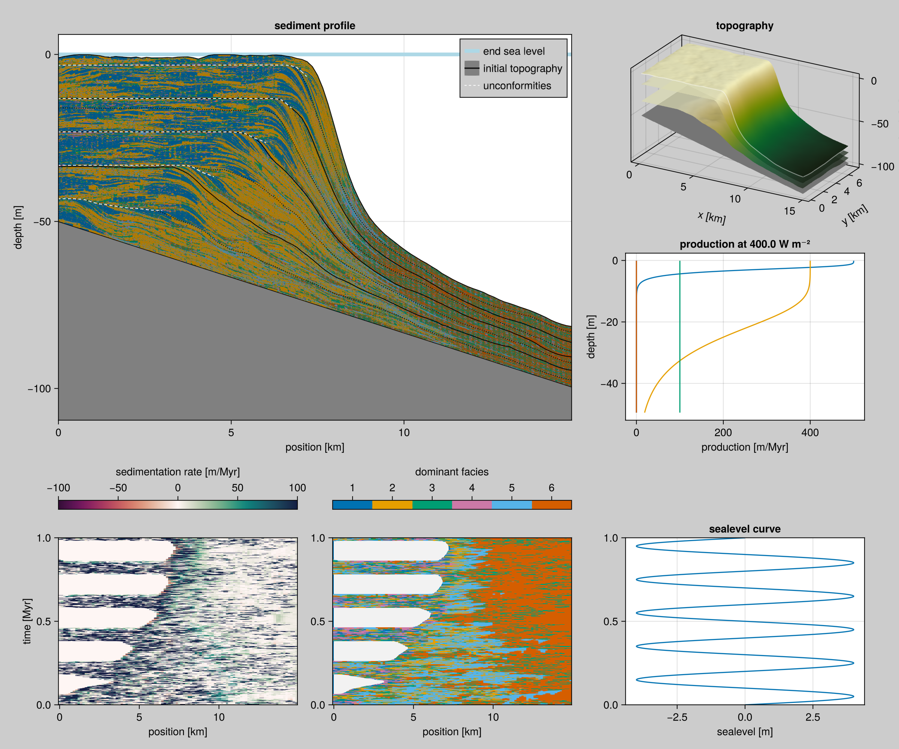

# Visualization

## Colours

We like to use colorblind safe pallete of colours as described on [Paul Tol's website](https://personal.sron.nl/~pault/): '#4477AA', '#EE6677', '#228833', '#CCBB44', '#66CCEE', '#AA3377', '#BBBBBB'.

## Project Extension

The Project Extension requires a front-end where the available methods are exposed.

``` {.julia file=src/Visualization.jl}
module Visualization
export sediment_profile!, sediment_profile, sediment_proportion!, sediment_proportion, wheeler_diagram!, wheeler_diagram, production_curve!,
       production_curve, glamour_view!, coeval_lines!, summary_plot, dominant_facies!, sediment_accumulation!

function print_instructions(func_name, args)
    println("Called `$(func_name)` with args `$(typeof.(args))`")
    println("This is an extension and only becomes available when you import {Cairo,GL,WGL}Makie before using this.")
end

function profile_plot! end

# profile_plot!(args...; kwargs...) = print_instructions("profile_plot!", args)
sediment_accumulation!(args...) = print_instructions("sediment_accumulation!", args)
dominant_facies!(args...) = print_instructions("dominant_facies!", args)
coeval_lines!(args...) = print_instructions("coeval_lines!", args)
sediment_profile!(args...) = print_instructions("sediment_profile!", args)
sediment_profile(args...) = print_instructions("sediment_profile", args)
wheeler_diagram!(args...) = print_instructions("wheeler_diagram!", args)
wheeler_diagram(args...) = print_instructions("wheeler_diagram", args)
production_curve(args...) = print_instructions("production_curve", args)
production_curve!(args...) = print_instructions("production_curve!", args)
stratigraphic_column!(args...) = print_instructions("production_curve!", args)
glamour_view!(args...) = print_instructions("glamour_view!", args)
summary_plot(args...) = print_instructions("summary_plot", args)
sediment_proportion!(args...) = print_instructions("sediment_proportion!", args)
sediment_proportion(args...) = print_instructions("sediment_proportion", args)
fence_diagram(args...) = print_instructions("fence_diagram", args)
fence_diagram!(args...) = print_instructions("fence_diagram!", args)

end  # module
```

``` {.julia file=ext/VisualizationExt.jl}
module VisualizationExt

include("WheelerDiagram.jl")
include("ProductionCurve.jl")
include("StratigraphicColumn.jl")
include("SedimentProfile.jl")
include("GlamourView.jl")
include("SummaryPlot.jl")
include("FenceDiagrams.jl")
end
```

## Summary collage



``` {.julia file=ext/SummaryPlot.jl}
module SummaryPlot

using CarboKitten.Visualization
import CarboKitten.Visualization: summary_plot
using CarboKitten.Output.Abstract: AbstractBundle, load, load_volume, load_slice
using CarboKitten.Output.Storage: header, data_volumes, data_slices, n_facies,
    time_axis, y_axis, sea_level, water_depth
using CarboKitten.Output.H5Reader: H5Bundle, read_header
using CarboKitten.Output.MemoryWriter: MemoryOutput
using CarboKitten.Utility: in_units_of
using HDF5
using Unitful
using Makie

summary_plot(filename::AbstractString; kwargs...) = load(b -> summary_plot(b; kwargs...), filename)
summary_plot(fid::HDF5.File; kwargs...) = summary_plot(H5Bundle(fid, read_header(fid)); kwargs...)
summary_plot(output::MemoryOutput; kwargs...) = summary_plot(load(output); kwargs...)

# The production curve is read from the `input` group of an HDF5 file.
# Other bundles don't store this information.
_production_curve!(fig, bundle::H5Bundle; kwargs...) =
    production_curve!(Axis(fig[2,3]), bundle.fid["input"]; kwargs...)
_production_curve!(fig, bundle::AbstractBundle; kwargs...) = nothing

function summary_plot(bundle::AbstractBundle; wheeler_smooth=(1, 1), show_unconformities=true)
    hdr = header(bundle)
    volumes = sort(data_volumes(bundle))
    slices = sort(data_slices(bundle))

    if isempty(slices) && isempty(volumes)
        @warn "No volume data or slice data stored. Cannot produce summary view."
        return nothing
    end

    fig = Figure(size=(1200, 1000), backgroundcolor=:gray80)

    volume_data = if isempty(volumes)
        @warn "No volume data stored, skipping topographic plots."
        nothing
    else
        if length(volumes) > 1
            @warn "Multiple volume data sets, picking first one."
        end

        volume_data = load_volume(bundle, volumes[1])
        ax = Axis3(fig[1, 3]; title="topography", zlabel="depth [m]", xlabel="x [km]", ylabel="y [km]")
        glamour_view!(ax, volume_data)
        volume_data
    end

    section_data = if isempty(slices)
        @warn "No profile data slice stored, taking section of volume data along x-axis."

        y_slice = div(length(y_axis(volume_data)), 2) + 1
        volume_data[:, y_slice]
    else
        load_slice(bundle, slices[1])
    end

    n_f = n_facies(section_data)

    ax1 = Axis(fig[1:2,1:2])
    sediment_profile!(ax1, section_data; show_unconformities = show_unconformities)
    axislegend(ax1; merge=true, backgroundcolor=:gray80)

    ax2 = Axis(fig[4,1])
    ax3 = Axis(fig[4,2])
    sm, df = wheeler_diagram!(ax2, ax3, section_data; smooth_size=wheeler_smooth)
    Colorbar(fig[3,1], sm; vertical=false, label="sedimentation rate [m/Myr]")
    Colorbar(fig[3,2], df; vertical=false, label="dominant facies", ticks=1:n_f)
    ax4 = Axis(fig[4,3], title="sealevel curve", xlabel="sealevel [m]",
               limits=(nothing, (first(time_axis(section_data)) |> in_units_of(u"Myr"),
                                 last(time_axis(section_data)) |> in_units_of(u"Myr"))))
    lines!(ax4, sea_level(hdr) |> in_units_of(u"m"), time_axis(hdr) |> in_units_of(u"Myr"))

    # Limit the production curve to the depths that actually occur in the run.
    max_depth = maximum(water_depth(something(volume_data, section_data)))
    _production_curve!(fig, bundle; max_depth=max_depth)

    linkyaxes!(ax2, ax3, ax4)

    fig
end

end
```
